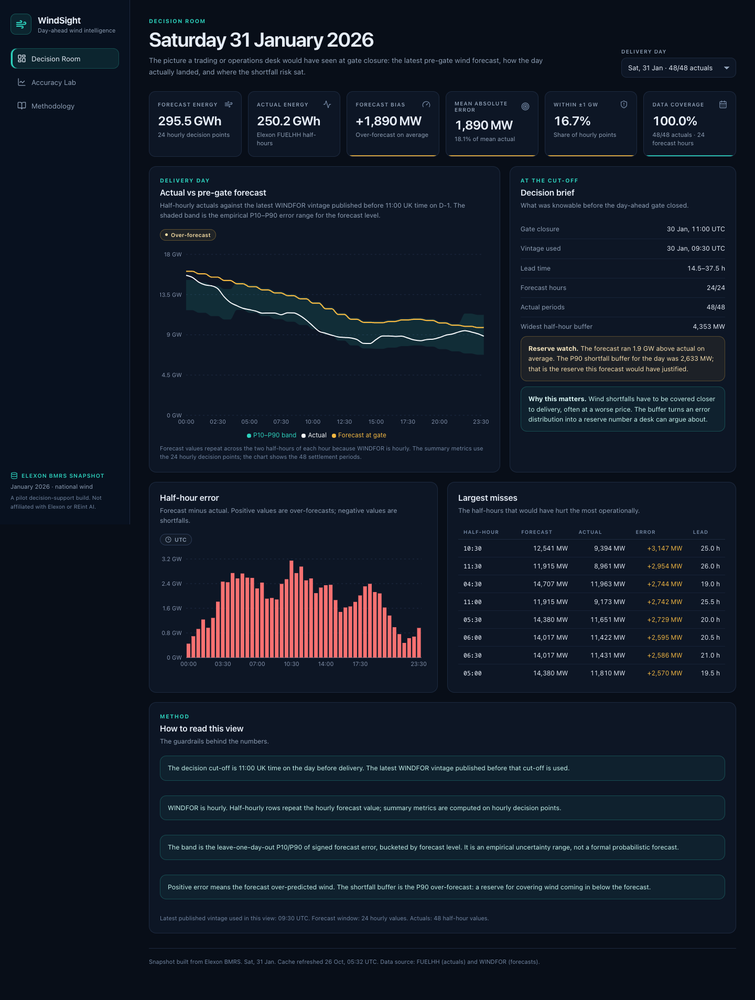
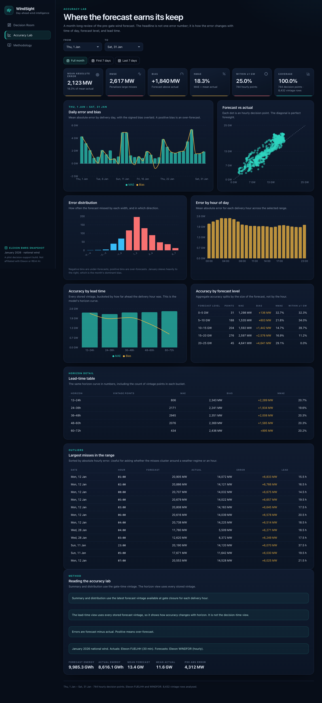

# WindSight

**Day-ahead wind forecast intelligence for a UK energy utility.**

WindSight answers two questions a trading or operations desk actually asks:

1. **What did the wind forecast say when the day-ahead gate closed?**
2. **How much should we trust it, given how it has landed this month?**

It uses national wind actuals and forecasts from Elexon BMRS for January 2026, served through a small React + FastAPI app in one Docker image.

> Pilot build for a take-home exercise. Not affiliated with Elexon or REint AI. Not operational trading advice.



## Live app and video

- **Live app:** <https://windsight-sda4.onrender.com>
- **Demo video:** _captioned silent walkthrough — link added after recording_

The repository name is intentionally anonymous for the exercise.

## What is in the app

### Decision Room

The pre-gate view for a selected delivery day:

- the latest `WINDFOR` vintage published before **11:00 UK time on D-1**;
- actual wind outturn over the 48 settlement periods;
- an empirical P10–P90 band by forecast level, built leave-one-day-out;
- forecast error, P90 shortfall buffer, and the largest half-hour misses.

### Accuracy Lab

A month-level review of forecast quality:

- MAE, RMSE, bias, nMAE, P90 error, and the share of hours within ±1 GW;
- daily error and bias;
- forecast-vs-actual scatter;
- error distribution and error by hour of day;
- accuracy by forecast level and by forecast lead time;
- the largest hourly misses in the selected range.

### Methodology

The data sources, gate-closure assumption, resolution handling, metric definitions, uncertainty method, limitations, and AI-tool disclosure.



## The data

| Item | Value |
| --- | --- |
| Period | 1–31 January 2026 |
| Scope | National wind only |
| Actuals | Elexon `FUELHH`, `fuelType=WIND`, 30-minute settlement periods |
| Forecasts | Elexon `WINDFOR`, hourly delivery hours, multiple publish vintages |
| Gate closure | 11:00 `Europe/London` on the day before delivery |
| Snapshot rows | 1,488 actuals · 8,432 forecast rows |
| Decision points | 744 hourly points (24 per day) |
| Snapshot size | ~1.3 MB SQLite |

The SQLite snapshot is committed at `backend/data/windsight.db`, so the app runs without network access. `backend/data/ingest-summary.json` records the ingest run.

### Data handling notes

- `FUELHH` requires `settlementDateFrom` / `settlementDateTo`. Generic `from` / `to` parameters are ignored by that endpoint.
- `WINDFOR` returns a rolling forecast horizon, so the ingestion adapter filters delivery `startTime` to the requested day after applying the publish-time window.
- Forecasts are hourly and actuals are half-hourly. The UI shows 48 half-hour periods by repeating each hourly forecast across its two settlement periods, but **all summary metrics use the 24 hourly decision points** (the actual is the mean of the two half-hours).
- Gate closure is an explicit assumption. A production version should read the actual auction calendar.

Source documentation:

- [FUELHH](https://bmrs.elexon.co.uk/api-documentation/endpoint/datasets/FUELHH)
- [WINDFOR](https://bmrs.elexon.co.uk/api-documentation/endpoint/datasets/WINDFOR)
- API base: `https://data.elexon.co.uk/bmrs/api/v1`

## Quick start

### Docker (recommended)

```bash
docker build -t windsight .
docker run --rm -p 8000:8000 windsight
```

Open <http://localhost:8000>. The image builds the React app, installs the Python API, and serves both from one FastAPI process.

### Local backend

Requires Python 3.12+.

```bash
python3.12 -m venv .venv
source .venv/bin/activate
pip install -r backend/requirements-dev.txt

cd backend
python -m app.ingest --rebuild
uvicorn app.main:app --reload --port 8000
```

The snapshot is already committed. `--rebuild` is only needed when refreshing from Elexon.

### Local frontend

Requires Node 20+.

```bash
cd frontend
npm ci
npm run dev
```

Vite serves the app at <http://localhost:5173> and proxies `/api` to `http://localhost:8000`.

To serve the built frontend from FastAPI:

```bash
cd frontend
npm run build
```

Then restart the backend. `app.main` mounts `frontend/dist` and falls back to `index.html` for client-side routes.

### Environment

| Variable | Default | Purpose |
| --- | --- | --- |
| `WINDSIGHT_DB` | `backend/data/windsight.db` | SQLite snapshot path |
| `PORT` | `8000` | Port used by the Docker command |
| `ELEXON_BASE_URL` | `https://data.elexon.co.uk/bmrs/api/v1` | Elexon API base |
| `VITE_API_BASE` | empty (same origin) | Optional frontend API base |

## API

| Method | Path | Description |
| --- | --- | --- |
| `GET` | `/api/health` | Liveness and snapshot readiness |
| `GET` | `/api/meta` | Sources, period, gate closure, counts, last ingest |
| `GET` | `/api/dates` | Delivery dates with actual/forecast coverage |
| `GET` | `/api/decision?date=YYYY-MM-DD` | Pre-gate forecast, actuals, band, summary |
| `GET` | `/api/accuracy?from=YYYY-MM-DD&to=YYYY-MM-DD` | Range metrics and breakdowns |

Examples:

```bash
curl http://localhost:8000/api/health
curl "http://localhost:8000/api/decision?date=2026-01-15"
curl "http://localhost:8000/api/accuracy?from=2026-01-01&to=2026-01-31"
BASE_URL=http://localhost:8000 ./scripts/smoke.sh
```

FastAPI also exposes interactive docs at <http://localhost:8000/docs>.

## Metrics

All metrics use hourly decision points, with forecast error defined as **forecast − actual**.

- **MAE**: mean absolute error (MW).
- **RMSE**: root mean squared error (MW); penalises large misses.
- **Bias**: mean signed error (MW); positive means over-forecast.
- **nMAE**: MAE ÷ mean actual generation.
- **P90 absolute error**: 90th percentile of absolute error.
- **P90 shortfall**: 90th percentile of positive error only; the reserve side of the distribution.
- **Within ±1 GW**: share of hourly points with absolute error ≤ 1,000 MW.
- **Coverage**: matched decision points ÷ expected points (24 per delivery day).
- **Energy**: sum of hourly MW ÷ 1,000, labelled GWh because the decision points are hourly.

The empirical band is a leave-one-day-out P10/P90 of signed error by forecast level, with a minimum of 20 observations per bucket and a global fallback. It is a framing device, not a calibrated probabilistic forecast. Full definitions are in the app's Methodology page and [GLOSSARY.md](GLOSSARY.md).

## Architecture

```
React + Vite SPA
      │  /api (JSON)
      ▼
FastAPI app  ──►  Store (SQLite snapshot)
      │
      └──►  analysis.py (pure domain logic, no HTTP or SQL)
```

- `backend/app/elexon.py` is the only module that knows Elexon's HTTP API and field names.
- `backend/app/ingest.py` is a repeatable CLI that writes the snapshot.
- `backend/app/analysis.py` turns domain records into decision and accuracy views. It is the main test surface.
- `backend/app/api.py` is a thin HTTP adapter over the store and analysis module.
- `backend/app/main.py` serves the API and the built SPA from the same origin.
- `frontend/src` is a three-page React app: Decision Room, Accuracy Lab, Methodology.

The single-image choice keeps the deployment small and avoids CORS and two-service drift. The cost is that data refresh is an explicit batch step rather than a background job. The trade-off and alternatives are recorded in [docs/adr/0001-simple-monolith.md](docs/adr/0001-simple-monolith.md).

### Repository layout

```
backend/
  app/
    api.py          HTTP endpoints
    analysis.py     decision and accuracy logic
    config.py       period, sources, paths
    domain.py       Actual / Forecast / DecisionPoint
    elexon.py       Elexon adapter
    ingest.py       snapshot CLI
    main.py         FastAPI + SPA serving
    store.py        SQLite cache
  data/             committed snapshot and ingest summary
  tests/            pytest suite
frontend/
  src/pages/        Decision Room, Accuracy Lab, Methodology
  src/components/   shared UI
docs/
  adr/              architecture decision record
  screenshots/      UI captures
Dockerfile
heroku.yml
render.yaml
scripts/smoke.sh
```

## Testing

```bash
cd backend
pytest -q
ruff check app tests
ruff format --check app tests
```

Current suite: **15 tests**, covering gate closure, vintage selection, half-hour aggregation, metric values, quantiles, histogram, store idempotence, Elexon filtering, the health/meta/dates/decision/accuracy endpoints, and invalid input.

Frontend:

```bash
cd frontend
npm run typecheck
npm run build
```

The build is also the frontend's typecheck. There is no browser test runner in the timebox; the UI was manually checked at desktop and mobile widths.

## Deployment

The app is Docker-first. Heroku and Render can run the image directly. A free Render web service is enough for a 1.3 MB snapshot.

### Heroku

```bash
heroku login
heroku create <anonymous-app-name>
heroku stack:set container -a <anonymous-app-name>
git push heroku main
heroku open -a <anonymous-app-name>
```

`heroku.yml` is included. The container command honours Heroku's `PORT`.

### Render

The live service is deployed from this repository on Render's free Docker plan:
<https://windsight-sda4.onrender.com>. The free instance spins down when idle, so
the first request can take 30–60 seconds. `render.yaml` points at the Dockerfile
and uses `/api/health` as the health check.

### Vercel

Vercel does not run Docker images. This repository is intentionally Docker-first because the assignment allows Heroku and because one image keeps the API and SPA together. A Vercel deployment would need a split setup: the React build as a static deployment and the FastAPI app as a Python serverless function, with the SQLite snapshot bundled into the function. That adapter is not included here to avoid shipping an untested second deployment path.

After deployment, run:

```bash
BASE_URL=https://<your-app> ./scripts/smoke.sh
```

## Limitations and next steps

- **One month, one fuel, one country.** January 2026 national wind is a narrow, biased sample. It is a pilot, not a seasonal validation.
- **Gate closure is assumed.** The app uses 11:00 UK time on D-1. Real auction timings and timezone edge cases should come from the market calendar.
- **Hourly forecast resolution.** `WINDFOR` does not provide half-hourly forecast precision, and the UI does not imply it does.
- **No market data.** The output is MW and GWh. A desk also needs prices, system margin, and imbalance exposure before this becomes position sizing.
- **Empirical uncertainty.** The P10/P90 band is not calibrated. A next step is proper probabilistic calibration and a rolling backtest.
- **Refresh is manual.** Ingestion is a batch step. A production version would schedule it, version vintages properly, and serve the latest snapshot.
- **Next:** actual auction gate times, price and margin overlays, regional wind, forecast-vintage decay, backtesting, and a proper vintage store.

## AI tools

This build was developed with an AI coding assistant for scaffolding, implementation, tests, and documentation. The Elexon request/response shapes, date-boundary behaviour, dataset quirks, and all displayed numbers were checked against the live API and covered by automated tests. The committed snapshot is generated from Elexon BMRS by `backend/app/ingest.py`; no application data is synthetic or hand-edited.

## Credits

Data: [Elexon BMRS](https://bmrs.elexon.co.uk/). Charts: Recharts. Icons: Lucide. UI: React + Vite. API: FastAPI. Snapshot: SQLite.
